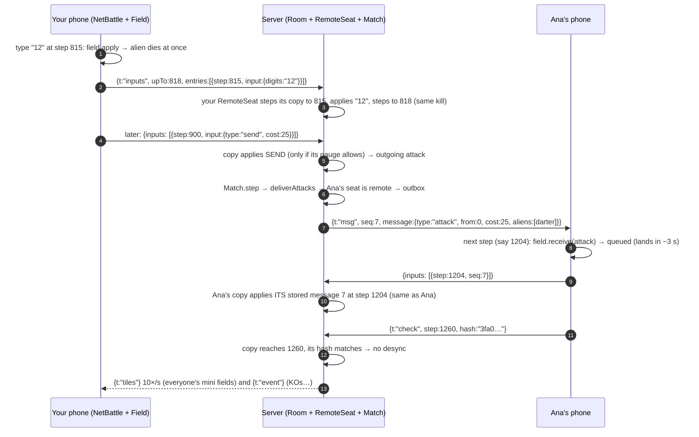

# The online server, end to end (netcode S1–S5)

How a match works when your friends are on other phones, read in the order
the bytes travel. Decisions and measurements are in
[`docs/NETCODE.md`](../NETCODE.md); this note is the walkthrough.

## The big idea in one paragraph

Nobody sends game state. Your phone sends **what you pressed and at which
step**. The server runs a **copy** of your field with the same code and the
same seed, feeds it your presses at the same steps, and gets the same state
(that's what S0 made true: bit-identical math). So the server *knows* your
field without trusting your phone, and decides who is knocked out, who gets
attacked and who wins. Your phone, meanwhile, never waits for the network:
it plays your field at once (prediction).

## One real flow: you type 12, it kills, your attack lands on Ana

Steps 8–10 are the trick that makes "no rollback" possible: **Ana's phone
picks the step** at which the attack applies, and tells the server. Her
prediction is never wrong, because nothing ever lands in her past.

## Tour: the ~50 lines that matter

1. `src/net/NetBattle.ts` — `step()` (apply inbox, then step, fingerprint
   every 60) and `poll()` (turn new log entries into `WireEntry`s: inputs
   as-is, messages as `{step, seq}`).
2. `server/RemoteSeat.ts` — `receive()`: the trust boundary. Every check
   (backwards, ahead of real time, order, unknown message) then
   `advanceTo(step)`, `apply`/`receive`, and `lateMessage()`.
3. `server/Room.ts` — `tick()` (real time → whole 60 Hz steps, catch-up
   capped) and `step()` (match step, outbox → `seat.send`, events, tiles,
   silent players → bot).
4. `src/sim/Match.ts` — `deliver()`: a remote seat's message goes to the
   outbox instead of into the field. That one `if` is the whole seam.
5. `src/net/protocol.ts` — `parseClient()`: rebuild every field, refuse the
   rest.

## Break it (and what to look for)

- **Fake lag:** `npm run net:bots -- --clients 8 --go --lag 120 --jitter 80`
  (or in the browser `?lag=150&jitter=80`). Look at `rttMs` (~300 ms) and
  that nobody is kicked: the 3 s incoming delay hides the lag.
- **What the first version of fake lag did:** one `setTimeout` per message
  reordered them; 5 of 8 clients were kicked ("step went backwards").
  Lesson: the network you simulate must keep the guarantees of the real
  one (TCP keeps order), or you debug bugs that don't exist.
- **The desync detector:** before `outgoing` was skipped, the first online
  match logged 324 desyncs (`[seat N] desync at step …` in the server
  log). Look for the first step, then diff `stateDump` on both sides.
- **Silence:** open a match in a browser tab and switch to another tab for
  5 s: the server log says `→ bot: stopped sending`, the game says
  "replaced by a bot".

## Your piece (intent level)

Read the comment at the top of `server/RemoteSeat.ts`. It lists what the
server refuses. **Write, in plain English, one more cheat or failure it
does NOT catch**, as a test case ("Given…, when…, the server should…, but
today it…"). Hint: think about what a client controls besides its inputs
(when it says it played a step, and which step it picks for an attack).

## Quiz (answer in the chat, no peeking)

1. Your phone sends `{step: 815, input: digits "12"}` but never sends where
   the aliens are. How does the server know whether "12" killed something?
2. Why does the *device* pick the step at which an attack applies, instead
   of the server?
3. What breaks if we remove `"outgoing"` from `SKIP_KEYS` again?
4. Why is pausing disabled online, and what does the server do if your tab
   stays hidden?
5. The server checks `upTo <= real time + 30 steps`. What cheat does that
   stop, and why does it allow 30 extra steps at all?

## One reading

Glenn Fiedler, *"Deterministic Lockstep"* and *"What Every Programmer
Needs To Know About Game Networking"* (gafferongames.com): the same
inputs-only idea, its alternatives (snapshots, state sync), and why games
choose each.
